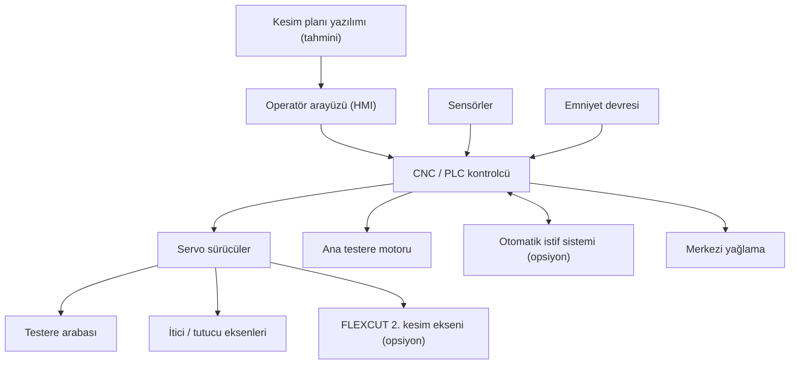

# Hafta 3: Yazılım ve Kontrol Mimarisi (Tahmini)

Katalog kontrol mimarisini açıklamamaktadır. Aşağıdaki yapı, makinenin teknik özelliklerinden ve bu tür CNC ebatlama makinelerinin genel yapısından yapılan bir tahmindir.

## Katmanlar

| Katman | Görevi | İlgili gereksinim |
|---|---|---|
| Operatör arayüzü (HMI) | Kesim planı seçme, parametre girişi, durum ve hata gösterimi | NFR-04 |
| CNC / PLC kontrolcü | Kesim planını hareket komutlarına çevirme, eksenleri senkron yönetme | FR-01, FR-02, FR-03 |
| Servo sürücüler ve motorlar | Testere arabası, itici/tutucu eksenleri, ana testere motoru | FR-01, FR-04 |
| Sensörler | Konum, testere yüksekliği, motor akımı, plaka algılama | FR-04 |
| Emniyet devresi | Acil stop, koruma kapakları, güvenli duruş | NFR-02 |
| Harici bağlantılar | İstif stok sistemi, kesim planı yazılımı (tahmini) | FR-06 |
| Bakım modülü | Merkezi yağlama zamanlaması ve uyarılar | FR-07 |

## Mimari şema

## Değerlendirme

- Mimari modüler olabilir, çünkü katalog donanımın opsiyonlarla seçildiğini söylüyor.
- Çok eksenli yapı (FLEXCUT) kontrolcüden yüksek senkronizasyon ister.
- Yazılım, arayüz ve veri aktarım biçimi katalogda yoktur, bu bölümler tahmindir.
