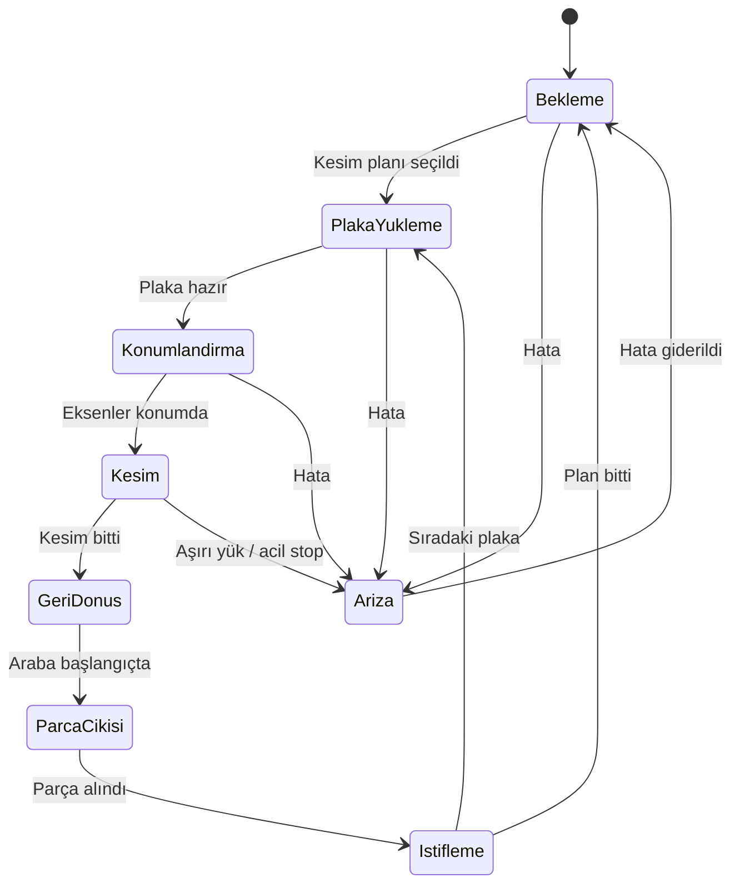

# Hafta 4: Çalışma Akışı ve SWOT Analizi

## 1. Durum diyagramı (tahmini)

Makinenin bir kesim döngüsündeki olası durumları aşağıdadır. Katalog bu akışı vermediği için tahmindir.

FLEXCUT seçeneğinde ikinci kesim ekseni aynı anda çalıştığı için "Kesim" durumu iki eksende paralel yürür. Çakışma önleme yazılımın görevidir (FR-03).

## 2. SWOT analizi

| | |
|---|---|
| **Güçlü yönler** | Yüksek hız (testere arabası 170 m/dk), FLEXCUT ile ikinci kesim ekseni sayesinde verim artışı, modüler donanım, merkezi otomatik yağlama ile düşük bakım ihtiyacı, otomatik istif sistemiyle entegre edilebilme |
| **Zayıf yönler** | Kontrol yazılımı ve arayüz hakkında herkese açık bilgi yok, HI-TRONIC özelliği açıklanmamış, fiyat bilgisi paylaşılmamış |
| **Fırsatlar** | Mobilya sektöründe otomasyon ve entegre üretim hatlarına artan talep, istif sistemiyle tam otomatik hücre kurulabilmesi, izleme ve Industry 4.0 çözümleri (tahmini) |
| **Tehditler** | Rakip üreticilerin benzer hızda makineleri, yüksek yatırım maliyeti (tahmini), yabancı markada servis ve yedek parça bağımlılığı (tahmini) |

## 3. Sonuç

Gabbiani G3, hız, modülerlik ve otomasyon entegrasyonu açısından güçlü görünmektedir. Analizin en büyük sınırı, kontrol yazılımının katalogda anlatılmamasıdır. Bu nedenle yazılım yönüne ait yorumlar tahmindir.
